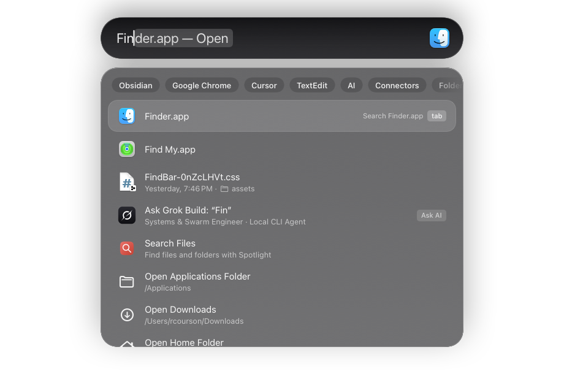
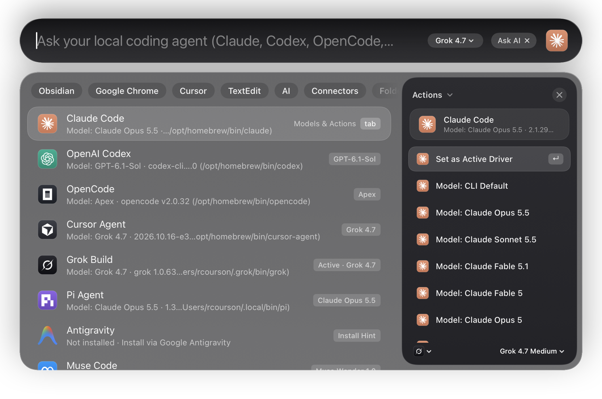
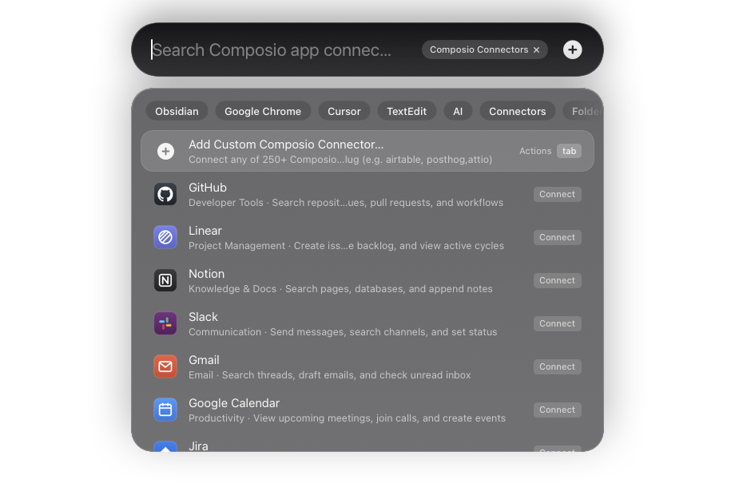
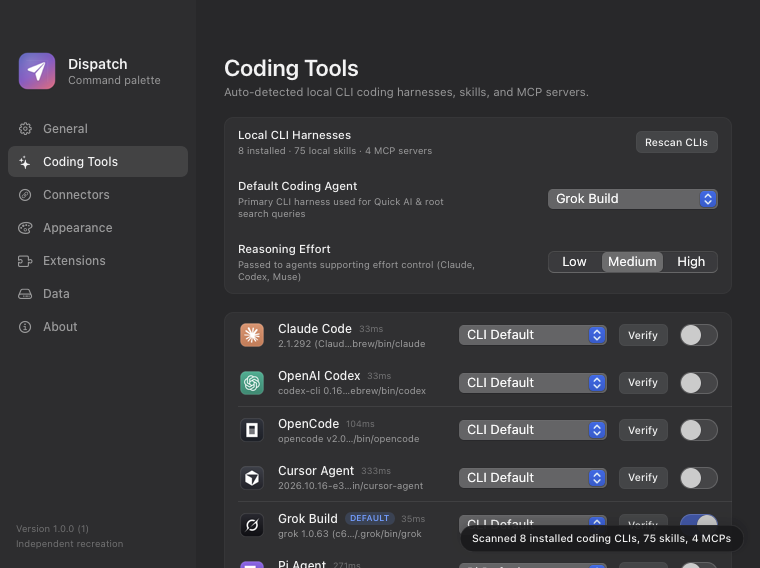

# Dispatch


A native macOS Spotlight-style command palette, coding agent hub, and app dispatcher built with SwiftUI, AppKit, Carbon global hotkeys, and Spotlight — using only the macOS Command Line Tools (zero external dependencies).



## Highlights

- **Native macOS Spotlight + Aside UI**: Two-part floating capsule search bar with inline completion badges (`Finder.app — Open`), filter chips, and a seamless slide-out Aside drawer inside the same window for Actions, AI Agent Chat, and Clipboard Preview.
- **Auto-Detected Coding Tools**: Automatically discovers installed local coding CLIs (`Claude Code`, `OpenAI Codex`, `OpenCode`, `Cursor Agent`, `Grok Build`, `Pi Agent`, `Antigravity`, `Muse Code`, `Gemini CLI`, `Aider`, `Ollama`), local `SKILL.md` skills (`~/.agents/skills`, `~/.claude/skills`, `~/.codex/skills`, `~/.cursor/skills`), and MCP servers (`~/.claude.json`, `~/.cursor/mcp.json`, `~/.config/opencode/opencode.json`).
- **Live Model & Reasoning Effort Switching**: Switch both coding providers and specific models (`Claude Opus 5.5`, `Claude Sonnet 5.5`, `GPT-6.1-Sol`, `Grok 4.7`, `Composer 2.5`, `Muse Wonder 1.0`, etc.) plus reasoning effort (`Low`, `Medium`, `High`) right from the search bar, Action drawer, or Settings.
- **Composio App Connectors**: 18 pre-bundled SaaS connectors with official brand icons (`GitHub`, `Linear`, `Notion`, `Slack`, `Gmail`, `Google Calendar`, `Jira`, `Figma`, `Vercel`, `Sentry`, `Supabase`, `HubSpot`, `Discord`, `Stripe`, `Datadog`, `Asana`, `Trello`, `Cloudflare`) plus one-click **Add Custom Connector** for any of 250+ Composio toolkits by slug.
- **Complete Desktop Command Suite**:
  - **27 Window Management Layouts** (halves, quarters, first/center/last thirds, two-thirds, all six sixths, almost maximize, reasonable size, make larger/smaller, next/previous display).
  - **Global Background Snippet Auto-Expansion** (`;keyword`, `!keyword`, or `:keyword:` expands automatically in any app).
  - **Clipboard History with Split Preview Pane** (text, file URLs, and images, pinning, word/char metadata, and optional auto-paste).
  - **Floating Notes & Confetti** (`Floating Notes` persistent scratchpad window and full-screen `Confetti` celebration).
  - **Calculator & Unit Conversions** (`2 + 2`, `sqrt(81)`, `15% of 80`, `10 km in mi`, `100 c to f`).
  - **Quicklinks, Emoji Search, System Controls, and Local Script Extensions**.

| Coding Agents & Aside Drawer | Composio Connectors | Settings — Coding Tools |
| --- | --- | --- |
|  |  |  |

## Requirements

- macOS 13 or newer (Apple Silicon or Intel).
- Swift Command Line Tools (`xcode-select --install`). Full Xcode is **not** required.
- Optional permissions:
  - **Accessibility** for window management, global snippet auto-expansion, Show Desktop, and auto-paste.
  - **Automation** for AppleScript system controls and Finder operations.

## Install

Download the signed, notarized universal installer (`Dispatch-1.0.0-universal.dmg`) from [**GitHub Releases**](https://github.com/robzilla1738/dispatch/releases/latest), drag `Dispatch.app` to `/Applications`, and launch it. Automatic updates are powered by **Sparkle 2.10** (`Dispatch → Check for Updates…`).

## Build from Source

```sh
python3 scripts/setup-sparkle.py
./scripts/build-app.sh
open dist/Dispatch.app --args --show
```

Build a signed & notarized universal release (requires Developer ID + `notarytool` profile + Sparkle Ed25519 key):

```sh
python3 scripts/release-macos.py \
  --identity "Developer ID Application: Your Name (TEAMID1234)" \
  --keychain-profile your-profile
```

## Tests & Diagnostics

```sh
swift run DispatchTests
./dist/Dispatch.app/Contents/MacOS/Dispatch --self-test
./dist/Dispatch.app/Contents/MacOS/Dispatch --diagnostics
```

- `DispatchTests`: 61 unit checks covering fuzzy matching, ranking, calculator/units, persistence, clipboard, extensions, window layouts, coding tool discovery, and Composio connectors.
- `--self-test`: 28 in-process application checks.

## Keyboard Shortcuts

| Shortcut | Action |
| --- | --- |
| `⌥Space` | Show/hide Dispatch (falls back to `⌃⌥Space` if `⌥Space` is already in use) |
| `↑` / `↓` | Move selection |
| `↵` | Execute selected item or action |
| `Tab` or `⌘K` | Smoothly open/close the Aside actions drawer |
| `esc` | Close Aside drawer, exit mode, or dismiss launcher |
| `⌘,` | Open Dispatch Settings |
| `⌘W` | Hide launcher |
| `⌘Q` | Quit Dispatch |

## License

MIT License — see [LICENSE](LICENSE).
